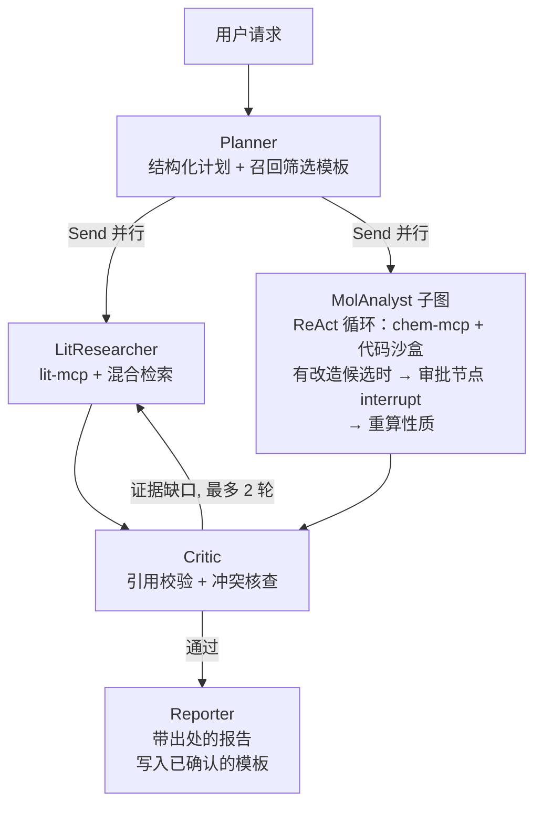

# PharmaFlow Agent：药物早期研发证据核查与分子评估多智能体系统（2 周轻量版开发计划）

## 0. 项目定位

- **一句话描述**：围绕 KRAS G12C 靶点，用多智能体完成三件事：临床安全性证据核查、候选分子类药性筛选、人工审批下的分子改造评估。
- **目标岗位**：两类都投，准备两版简历（见第 9 节）。
  - 互联网大厂、大模型公司的 Agent 开发实习：突出编排、MCP、沙盒、RAG、记忆、评测等工程能力和实测指标。
  - AI 制药、医疗大模型公司的智能体实习：突出临床证据口径对齐、RDKit 类药性评估等领域能力。
- **周期与资源**：
  - 2 周，每天 8 小时，共 112 小时。任务合计约 113.5 小时，比可用时间多约 1.5 小时，没有缓冲；落后时按第 8 节的顺序砍。
  - 不训练模型，推理用 OpenAI 兼容 API。默认用 DeepSeek：强模型 `deepseek-v4-pro`，便宜模型 `deepseek-flash`，所有调用关闭 thinking 模式（原因见第 5 节）。也可以换成 Qwen。
  - 数据全部来自免费公开接口：PubMed E-utilities、ClinicalTrials.gov API v2、openFDA、ChEMBL。化学计算用 RDKit。
  - 本地基础设施：用 Docker 运行 PostgreSQL、Qdrant 和代码沙盒。

## 1. 设计原则

1. 三个用例共用一个靶点（KRAS G12C）、一套数据和一张图。
2. 每个技术点只做一个落点，但要能运行、有测试、进评测集。
3. 优先用现成能力：Langfuse Cloud、Qdrant 自带的混合检索、LangGraph 官方的 Postgres 检查点和 Store。
4. 评测基线在第 5 天建好，之后每个任务都往评测集里加对应条目。
5. 简历只写实测数字，不写预设目标。

## 2. 技术点覆盖

| JD 常见要求 | 本项目的落点 |
|---|---|
| Agent 编排、状态机 | 手写 LangGraph StateGraph：条件边、循环、步数上限 |
| ReAct、Function Calling | 单 Agent 版本（同时作为评测基线）和每个 worker 子图 |
| MCP | `lit-mcp`、`chem-mcp` 两个 FastMCP Server，用 `langchain-mcp-adapters` 接入，每个 Server 一个长期会话；开发和评测用 stdio，部署用 HTTP |
| 多智能体、Planning、Reflection | Planner、LitResearcher、MolAnalyst、Critic 四个节点；`Send` 并行；Critic 回环最多 2 轮 |
| 结构化输出 | Pydantic + `with_structured_output`（function_calling 方式）；DeepSeek 关闭 thinking 后才能强制调用指定函数 |
| RAG | Qdrant 单个 collection 存 dense 向量和 BM25 稀疏向量，RRF 融合，cross-encoder 重排，查询改写 |
| 短期 / 长期记忆 | State + `AsyncPostgresSaver` 检查点；`AsyncPostgresStore` 存人工确认过的筛选模板 |
| 数据库 | PostgreSQL：检查点和长期记忆共用一个连接池，任一 api 实例都能恢复暂停中的会话；评测结果存进自己设计的表，报告用 SQL 生成 |
| Human-in-the-Loop | `interrupt()` + `Command(resume=...)` 审批分子改造方案；审批节点在 MolAnalyst 子图里 |
| Code Interpreter、沙盒 | Docker SDK 一次性容器，限制资源和网络，按错误类型自愈 |
| 上下文工程 | 工具返回字段裁剪、子图只回传结构化结果、超预算时摘要历史消息、技能按需加载 |
| Agent Skills | 领域流程写成符合开放标准的 SKILL.md；节点平时只看到技能名称和简介，需要时用 `load_skill` 加载正文 |
| 服务化、流式 | FastAPI 异步接口 + SSE；前端在聊天里实时显示节点和工具调用 |
| 可观测性 | Langfuse Cloud：trace、session、token、耗时 |
| 评测 | 30 条任务评测 + 15 条检索标注；规则校验 + LLM-as-judge；结果入库，对比和回归清单用 SQL 生成；单/多 Agent 对比和消融实验 |
| 模型路由、成本 | 按节点配置强/弱模型，记录每次运行的 token |
| 可靠性 | 超时、重试、限流、HTTP 录制回放；进程重启或换实例后能从检查点续跑 |
| 安全 | 沙盒隔离；上传文件校验；检索文本按数据处理，不当作指令；检查点开启严格反序列化；技能文件读取限制在技能目录内 |
| 部署、工程化 | docker-compose（含 Postgres、Qdrant）；GitHub Actions 跑单测和 Postgres 集成测试 |

## 3. 业务用例

三个用例都围绕 KRAS G12C 和两个已上市药物 sotorasib、adagrasib。

1. **用例 1：临床安全性证据核查**
   - 输入示例：“对比 sotorasib 和 adagrasib 在 NSCLC 三期试验中 ≥3 级治疗相关不良事件。”
   - 流程：拆分检索词 → 调用 PubMed、ClinicalTrials.gov、openFDA 工具和本地证据库 → 加载“不良事件可比性判断”技能 → 抽取结构化的不良事件记录 → 按口径判断可比性 → 有缺口时补充检索 → 输出带出处的对比表和冲突说明。
2. **用例 2：候选分子类药性筛选**
   - 输入示例：上传候选化合物 CSV，要求按 Lipinski 和 PAINS 筛选，再做自定义排序和作图。
   - 流程：加载“类药性筛选”技能 → 固定规则由 chem-mcp 确定性计算 → 开放式分析由模型写 pandas 脚本，在 Docker 沙盒里执行 → 代码报错时根据 traceback 自动修正。
3. **用例 3：人工审批下的分子改造**
   - 输入示例：“这个先导分子 LogP 偏高，给出改造方案并重新评估。”
   - 流程：chem-mcp 按预定义的结构变换规则枚举类似物 → 模型排序并解释 → `interrupt()` 暂停，等待人工审批或修改 → 恢复后重新计算性质 → 人工确认过的“靶点 → 筛选模板”写入长期记忆，下次会话自动召回。

## 4. 架构



| 服务 | 内容 |
|---|---|
| `lit-mcp` | PubMed、ClinicalTrials.gov、openFDA 工具，`search_evidence` 证据检索 |
| `chem-mcp` | 性质计算、Lipinski/PAINS 过滤、类似物枚举 |
| `api` | FastAPI + LangGraph；加载技能；调用 Docker 沙盒 |
| `ui` | Streamlit：聊天（内联显示执行状态）和审批表单 |
| `postgres` | 会话检查点（含 HITL 暂停时的状态）、长期记忆、评测结果（`eval` schema） |
| `qdrant` | 证据库 |

```
pharmaflow/
├── mcp_servers/
│   ├── lit/        # 文献、临床试验、说明书工具
│   └── chem/       # RDKit 工具
├── agent/          # 图、节点、State、LLM 客户端、技能加载、持久化（Postgres 连接池、检查点、Store）
├── skills/         # Agent Skills：ae-comparability、druglike-screening
├── rag/            # 语料拉取、切块、建索引、检索
├── sandbox/        # 沙盒镜像和执行器
├── api/            # FastAPI
├── ui/             # Streamlit
├── eval/           # 评测集、运行器、judge、建表 SQL、报告查询
├── data/           # 候选集、上传文件、录制的 HTTP 响应、语料
├── tests/
│   ├── unit/         # 用 InMemorySaver，不连数据库
│   └── integration/  # 连真实 Postgres
└── docker-compose.yml
```

## 5. 关键技术决定

- **HITL 用 `interrupt()`，不用 `interrupt_before`**：LangGraph 文档说明静态断点用于调试，HITL 应在节点内调用 `interrupt()`，再用 `Command(resume=...)` 恢复。恢复时节点会从头重跑，所以 `interrupt()` 之前不能有非幂等的副作用。
- **审批节点放在 MolAnalyst 子图里**：如果审批是父图里 MolAnalyst 下游的独立节点，LitResearcher 会在下一个超步先触发 Critic，Critic 在分子结果出来前跑一遍，审批恢复后又跑一遍，Reporter 也可能出两份报告。审批放进 MolAnalyst 子图（ReAct 循环 → 审批 → 重算性质）后，父图里 MolAnalyst 只是一个节点，Critic 等两个分支都完成才跑；子图恢复时也只从审批节点重跑，前面的 LLM 排序和工具调用不会重来。恢复时传回人工最终确认的 SMILES 列表，不传候选序号，避免重跑后候选顺序变了而批错分子。
- **MCP 工具错误直接回给模型**：`langchain-mcp-adapters` 默认把工具执行错误包装成 `status="error"` 的 ToolMessage 交给模型，自愈逻辑可以直接利用。
- **MCP 子进程的环境变量和会话**：用 stdio 启动的 MCP 子进程默认只继承一小部分环境变量，回放模式、录制目录和 NCBI API key 要在 `MultiServerMCPClient` 的 `env` 里显式传。`get_tools()` 默认每次调用工具都新开一个会话，stdio 下等于每次重启子进程、重新加载模型，所以启动时用 `client.session()` 为每个 Server 开一个长期会话。评测始终用 stdio 拉起自己的 MCP 子进程并传回放配置；compose 里的 MCP 服务只用来演示，保持 live 模式。
- **DeepSeek 调用关闭 thinking 模式**：所有 DeepSeek 调用都传 `extra_body={"thinking": {"type": "disabled"}}`，换模型或换供应商时先跑 Task 3 的兼容性脚本。原因是 `deepseek-v4-pro` 和 `deepseek-flash` 默认开启 thinking，而这个模式下：
  - 不接受 `tool_choice="required"` 或指定函数，LangChain 的 `with_structured_output(method="function_calling")` 会直接报 400。
  - `temperature` 不生效，评测没法固定采样。
  - 带工具的多轮对话必须回传每条 assistant 消息的 `reasoning_content`，漏传就报 400。LangChain 的 DeepSeek 集成出过漏传的问题。
- **语料走 API，不解析 PDF**：CDE/FDA 指导原则讲的是试验设计和申报规范，没有具体药物的不良反应率，对冲突核查帮助不大。改用 PubMed 摘要、ClinicalTrials.gov 结果数据和 openFDA 说明书。语料是英文，不需要中文分词。
- **检索只用 Qdrant + FastEmbed**：Qdrant Query API 用 prefetch + RRF 融合 dense 和 BM25 两路结果。FastEmbed 提供能在 CPU 上运行的 dense、BM25 稀疏和 cross-encoder 重排模型，不需要 GPU。FastEmbed 默认把模型缓存在系统临时目录，容器重建后会重新下载，所以用 `FASTEMBED_CACHE_PATH` 固定缓存路径，镜像构建时预下载，lit-mcp 启动时加载一次。
- **冲突核查先对齐口径**：ClinicalTrials.gov 按“严重 / 其他”报告不良事件，不按 CTCAE 分级；论文通常报“任意级别 / ≥3 级”。只有药物、剂量、口径、人群都一致的数据才直接比较数值。
- **模型不直接写 SMILES**：LLM 生成的 SMILES 经常非法或化学上不合理。类似物由 RDKit 按反应规则枚举，模型只负责排序和解释。批量分子在工具之间传数据集 ID，不让模型逐字抄写。
- **领域流程写成 Agent Skills**：不良事件可比性判断和类药性筛选的操作说明写成 SKILL.md。节点的系统提示词里只放技能名称和简介，需要时调用 `load_skill` 加载正文，正文引用的参考文件再按需读取。判断逻辑（可比性规则、Wilson 区间）留在代码里，技能只写怎么用工具、怎么解释结果。格式按 [Agent Skills 规范](https://agentskills.io/specification)：frontmatter 只用必填的 `name` 和 `description`，`name` 只含小写字母、数字和连字符，并且和目录名一致。这样同一套技能也能放进其他支持这个标准的工具。
- **持久化统一用 Postgres**：检查点和长期记忆都用 `langgraph-checkpoint-postgres` 提供的 `AsyncPostgresSaver` 和 `AsyncPostgresStore`，共用一个连接池。原因是 api 可能跑多个 worker 或多个实例：用户提交审批后，恢复请求可能落到另一个实例上，它必须读到同一份检查点。SQLite 同一时刻只允许一个写入者，也没法跨机器共享。单测用 `InMemorySaver`，持久化相关的集成测试连真实 Postgres。
- **长期记忆存筛选模板**：sotorasib（MW≈561）和 adagrasib（MW≈604）都超过 Lipinski 的 MW≤500，筛选阈值需要按靶点调整。人工确认过的“靶点 → 检索词、筛选阈值”存进 `AsyncPostgresStore`，下次会话按靶点精确召回。Store 不配置 `index`（语义检索），所以不需要 pgvector，用官方 `postgres:16` 镜像即可。
- **检查点开启严格反序列化**：检查点反序列化默认允许任意 Python 类型，能写库的人就可能借此执行代码。设置 `LANGGRAPH_STRICT_MSGPACK=true` 后，LangGraph 编译图时会从 State、节点和通道的类型标注里收集类型，自动加进白名单，子图也一样。所以 State 字段要标注具体类型（如 `list[AEEvidence]`），不要把自定义对象放进 `Any` 或 `dict` 字段；实在要放，就手动加进 `allowed_msgpack_modules`。
- **Langfuse 用云版**：自托管需要 web、worker、Postgres、Redis、ClickHouse、MinIO 六个容器。Cloud 免费档每月 5 万计费单位，每个 trace、span、评分各算一个，本计划的评测规模用不完。
- **评测可复现**：用 HTTP 录制回放固定 PubMed 等外部接口的数据。固定模型配置，将 `temperature` 设为 0 以减少采样波动，DeepSeek 调用关闭 thinking。规则按解析后的字段判分，开放式答案由 LLM-as-judge 按评分细则判分。模型输出和 judge 分数仍可能波动。每次评测用新的 `user_id` 命名空间，避免开发时存下的模板影响结果。
- **评测结果存进 Postgres**：评测的运行、用例和结果存进 `eval` schema 下自己设计的三张表，用 psycopg 手写 SQL，不用 ORM。配置对比、失败分布和回归用例清单都由 SQL 生成，每条结果带 Langfuse 的 trace_id。Langfuse 用来看单条 trace，数据库用来做跨运行的统计和对比。
- **沙盒和部署的取舍**：api 放进容器后，要启动沙盒容器就得挂载 `/var/run/docker.sock`，相当于把宿主机 Docker 的 root 权限交给 api。本项目只在本地演示时这样做，README 写明风险和生产替代方案（gVisor、Firecracker，或 E2B 这类托管沙盒）。

## 6. 开发计划

| 任务 | 内容 | 估时 | 累计 | 预计完成 |
|---|---|---|---|---|
| Task 1 | 脚手架 + chem-mcp | 6h | 6h | 第 1 天 |
| Task 2 | lit-mcp + 录制回放 | 8h | 14h | 第 2 天 |
| Task 3 | 单 Agent ReAct 基线 + Postgres 持久化 | 7.5h | 21.5h | 第 3 天 |
| Task 4 | FastAPI + SSE + 最小前端 | 6h | 27.5h | 第 4 天 |
| Task 5 | Langfuse 追踪 + 评测框架（结果入库）+ 基线 | 9.5h | 37h | 第 5 天 |
| Task 6 | Docker 代码沙盒 + 自愈 | 8h | 45h | 第 6 天 |
| Task 7 | 混合检索 RAG | 12h | 57h | 第 8 天 |
| Task 8 | 多智能体编排 + 上下文压缩 | 16h | 73h | 第 10 天 |
| Task 9 | 证据结构化抽取 + 冲突核查 | 12h | 85h | 第 11 天 |
| Task 10 | Agent Skills 按需加载 | 3h | 88h | 第 11 天 |
| Task 11 | HITL 分子改造 + 长期记忆 | 8.5h | 96.5h | 第 13 天 |
| Task 12 | 评测补全 + 对比实验 + Bad Case 迭代 | 8.5h | 105h | 第 14 天 |
| Task 13 | 部署 + 文档 + 简历 | 8.5h | 113.5h | 第 14 天，超 1.5h |

里程碑：
- **第 5 天（Task 5 完成）**：单 Agent、MCP、Postgres 持久化、SSE、追踪和评测基线就绪，可以写进简历开始投。
- **第 11 天（Task 10 完成）**：沙盒、RAG、多智能体、冲突核查和技能按需加载齐全。
- **第 14 天（Task 13 完成，超出约 1.5 小时）**：HITL、长期记忆、完整评测和一键部署全部完成。

没有缓冲：任务合计约 113.5 小时，比 2 周的 112 小时多约 1.5 小时。Task 7、8、9 最容易超时，一旦落后就按第 8 节的顺序砍。

### Task 1：脚手架 + chem-mcp（6 小时）
- **目标**：一个独立运行、任何 MCP 客户端都能调用的 RDKit 工具服务。
- **做法**：
  - 用 uv 管理依赖，配好 ruff、pytest、pytest-asyncio；按第 4 节建目录；密钥只放 `.env`，仓库里提交 `.env.example`。
  - 用 FastMCP 实现两个工具，输入输出用 Pydantic 定义：
    - `compute_properties`：计算 MW、LogP、TPSA、HBD/HBA、QED。
    - `filter_druglike`：Lipinski 阈值可配置，PAINS 用 RDKit FilterCatalog。
  - 工具同时接受 SMILES 列表和数据集 ID（对应 `data/` 下的 CSV）。
  - 非法 SMILES 逐条标记错误，其余分子照常计算。
  - 从 ChEMBL 导出约 50 个 KRAS G12C 相关化合物（SMILES + IC50），存为 `data/candidates.csv`，网页下载或 API 都可以。
- **测试**：
  - 已知分子的描述符断言，例如 sotorasib 的 MW≈560.6。
  - PAINS 阳性样例能命中。
  - 混入非法 SMILES 时，其余结果仍然正确。
  - 通过 MCP 客户端会话调用工具的集成测试。
- **演示**：在 MCP Inspector 或 Claude Desktop 里对候选集计算性质并做 Lipinski 过滤。

### Task 2：lit-mcp + 录制回放（8 小时）
- **目标**：覆盖文献、临床试验、药品说明书三类数据的工具服务，测试结果可复现。
- **做法**：
  - 实现四个工具：
    - `search_pubmed`：用 E-utilities 检索，直接返回摘要。
    - `search_trials`：在 ClinicalTrials.gov v2 按疾病、药物、分期检索。
    - `get_trial_adverse_events`：解析 `adverseEventsModule` 里的组别、受试人数、严重和其他不良事件计数。
    - `get_label_section`：读取 openFDA 说明书的 `adverse_reactions`、`adverse_reactions_table` 等字段。一份说明书的完整 JSON 约 70KB，只返回请求的字段。
  - 返回值只保留关键字段，列表限长，长文本截断后附 ID。
  - 用 httpx 异步客户端，加超时、指数退避重试和 PubMed 限流（无 key 每秒 3 次，有 key 每秒 10 次）。
  - HTTP 层用文件缓存做录制回放，用环境变量切换 `live`、`record`、`replay`，录制目录也由环境变量指定。
- **测试**：用录制的响应测解析、字段裁剪、429 退避和超时重试；断网时 replay 模式必须全部通过。
- **演示**：在 Inspector 里查 CodeBreaK 200（NCT04303780，sotorasib 对比多西他赛的三期试验）的严重不良事件表，以及 sotorasib 说明书的不良反应表。

### Task 3：单 Agent ReAct 基线 + Postgres 持久化（7.5 小时）
- **目标**：一个能调用两个 MCP Server、支持多轮和续聊的 Agent，会话状态存在 Postgres，之后作为评测基线。
- **做法**：
  - 先写兼容性脚本 `scripts/check_model.py`，验证强制 `tool_choice`、结构化输出解析、`temperature=0` 下短回答的稳定性和多轮工具调用。高温采样的分布只作诊断参考。换模型时重跑。如果关闭 thinking 后强制 `tool_choice` 仍被拒绝，结构化输出改用 JSON 输出模式（`response_format={"type": "json_object"}`），再用 Pydantic 校验，失败就重试。
  - 写 OpenAI 兼容客户端，通过 `base_url` 和 `model` 切换 DeepSeek 或 Qwen，配置超时和重试。DeepSeek 始终带上 `extra_body={"thinking": {"type": "disabled"}}`。在 `.env.example` 提供 `LLM_DISABLE_THINKING`，设为 `true` 时也发送该字段，适用于接受 DeepSeek thinking 参数格式的端点。
  - 用 `MultiServerMCPClient` 连接两个 MCP Server。启动时用 `client.session()` 为每个 Server 开一个长期会话，再用 `load_mcp_tools(session)` 加载工具。不用 `get_tools()` 的默认行为，它每次调用工具都新开会话，stdio 下等于每次重启子进程。stdio 子进程默认只继承少量环境变量，回放模式、录制目录和 NCBI API key 要在 `env` 里显式传。
  - 手写 StateGraph，包含 agent 节点、ToolNode、条件边和最大步数。
  - 建 `docker-compose.yml`，先只放 `postgres:16`（配数据卷）。Task 7 加 qdrant，Task 13 再补应用服务。
  - 依赖加 `langgraph-checkpoint-postgres` 和 `psycopg[binary,pool]`。按 `DATABASE_URL` 建一个 `AsyncConnectionPool`，连接参数必须带 `autocommit=True` 和 `row_factory=dict_row`：缺前者，`setup()` 建的表可能没提交；缺后者，读检查点时会报 `TypeError`。这个连接池给 `AsyncPostgresSaver` 和 Task 11 的 `AsyncPostgresStore` 共用。
  - 启动时调用 `setup()` 建表。在 `.env` 里设置 `LANGGRAPH_STRICT_MSGPACK=true`；State 字段标注具体类型，LangGraph 编译时会自动把这些类型加进白名单。
  - 按 `thread_id` 持久化会话，提供 CLI 入口。
- **测试**：
  - 单测（`InMemorySaver`）：用预设 tool_calls 的假模型测路由、终止条件和步数上限。
  - 集成测试（真实 Postgres）：重启进程后，同一 `thread_id` 能接上之前的对话。测试一律用随机的 `thread_id`。
  - 集成测试（真实 Postgres）：用一个测试用的小图，在父图和子图的 State 里各放一个自定义 Pydantic 对象，存进检查点再读回，类型不变。
  - 一次运行里多次调用工具，每个 MCP Server 只启动一个子进程；断网时 replay 模式能正常返回，说明回放配置传到了子进程。
- **演示**：在 CLI 里先问“sotorasib 三期试验的严重不良事件”，再问“候选集里哪些满足 Lipinski”；退出后用同一 `thread_id` 继续对话，并用 `psql` 查看这个 `thread_id` 存下的检查点。

### Task 4：FastAPI + SSE + 最小前端（6 小时）
- **目标**：在浏览器里流式看到回答和工具调用过程。
- **做法**：
  - 接口包括创建会话、发起运行（SSE）、查询会话状态和上传 CSV。上传时校验大小、行数和必需列，返回数据集 ID。文件存在共享目录，chem-mcp 按 ID 读取；沙盒执行时由 api 把文件拷进容器。
  - 把 LangGraph 的流式输出映射为 `token`、`node`、`tool_call`、`tool_result`、`error`、`done` 六类事件。
  - Streamlit 单页聊天，回答上方用 `st.status` 实时显示当前节点和工具调用。
- **测试**：用 httpx 异步客户端测 SSE 事件的顺序和格式（由假模型驱动），再测上传校验的边界情况。
- **演示**：在浏览器里提问，回答逐字出现，上方实时显示正在调用的工具和参数。

### Task 5：Langfuse 追踪 + 评测框架（结果入库）+ 基线（9.5 小时）
- **目标**：第 5 天有可量化的基线，可以开始投递。
- **做法**：
  - 接入 Langfuse Cloud 的 LangChain CallbackHandler。session 对应 `thread_id`，用 tag 标记版本和 git commit。
  - 每条评测用 YAML 描述，包括输入、期望工具、参数约束和检查规则（关键字段、数值范围）。开放式回答用 LLM-as-judge，配评分细则。
  - 先写 12 条：单工具 6 条、多跳 3 条、异常 3 条。用同一配置跑两轮基线，记录汇总指标和逐用例结果的差异。工具一律走 replay，temperature 设为 0，每条用例用新的 `thread_id`。
  - 评测运行器用 stdio 拉起自己的 MCP 子进程，并显式传回放配置，不连 compose 里的服务。
  - 评测结果写进 Postgres 的 `eval` schema。三张表自己设计，建表 SQL 放在 `eval/schema.sql`，用 psycopg 手写 SQL，不用 ORM：
    - `eval.runs`：运行 ID、tag、git commit、配置（JSONB）、开始和结束时间。
    - `eval.cases`：用例 ID、类别。每次运行前从 YAML 同步，用 `INSERT ... ON CONFLICT DO UPDATE`。
    - `eval.results`：主键是（运行 ID, 用例 ID），外键分别指向前两张表；记录是否成功、工具选择是否正确、参数是否合法、judge 分数、失败类型（用 `CHECK` 约束限定取值）、输入 token、耗时和 Langfuse 的 trace_id。
  - 指标：工具选择准确率、参数合法率、任务成功率、平均 token、端到端耗时。指标表由 SQL 按运行和用例类别分组汇总。
  - GitHub Actions 跑单测和集成测试：用假模型加 replay，不需要 API key；集成测试连 Actions 提供的 Postgres 服务容器。
- **测试**：
  - 指标计算和 judge 输出解析的单测。
  - 集成测试：插入构造好的运行和结果，断言汇总查询的数值正确。
- **演示**：运行 `python -m eval.run --tag v1` 输出指标表，在 Langfuse 里能逐条打开 trace。

### Task 6：Docker 代码沙盒 + 自愈（8 小时）
- **目标**：Agent 能写 pandas/RDKit 脚本处理上传的数据，并在隔离环境里执行。
- **做法**：
  - 沙盒镜像用 python-slim，装 pandas、rdkit、matplotlib，以非 root 用户运行。
  - 每次执行都起一个一次性容器：
    - `network_mode="none"`
    - 内存 512MB，设 CPU 配额和 `pids_limit`
    - `cap_drop=["ALL"]` 和 `no-new-privileges`
    - 先 `start()` 再 `wait(timeout=15)`，15 秒只算脚本执行时间，超时就 kill
  - 输入输出文件用 `put_archive` / `get_archive` 传，不用 bind mount，api 以后放进容器也不用改。
  - `run_python` 工具返回 stdout、精简后的 stderr 和生成的文件。
  - 日志分段记录创建容器、传文件、执行、回收的耗时，用来分析自愈重试拉长的总延迟。Docker Desktop 上创建和回收容器的开销要实测。
  - 按错误类型分别处理：
    - 代码错误：把 traceback 回传给模型修正，最多 3 轮。
    - 超时或 OOM（用 `OOMKilled` 区分）：不原样重试，提示模型缩小规模。
    - 非法 SMILES：在 chem-mcp 层处理，不进修复循环。
  - 固定规则走 chem-mcp；自定义排序、统计、画图这类开放需求才进沙盒。
- **测试**：
  - 访问外网会失败。
  - 超内存会被杀掉。
  - 死循环会超时。
  - fork 炸弹会被 `pids_limit` 拦住。
  - 用假模型脚本化“报错、修正、成功”的完整流程。
- **演示**：上传候选 CSV，要求“按 QED 降序取前 10，并画 MW-LogP 散点图”。聊天里显示生成的代码、一次失败、自动修正和最终图表。评测集加入自愈类条目。

### Task 7：混合检索 RAG（12 小时）
- **目标**：本地证据库，支持混合检索和重排，结果带出处。
- **做法**：
  - compose 里加 `qdrant` 服务，配数据卷。
  - 用 Task 2 的工具批量拉取语料，存成 JSONL：
    - 约 200 篇 KRAS G12C 相关的 PubMed 摘要
    - CodeBreaK 200（NCT04303780）和 KRYSTAL-12（NCT04685135）两个三期试验的结果数据，两者都已在 ClinicalTrials.gov 公布结果
    - sotorasib 和 adagrasib 说明书的不良反应和警告章节
  - 按段落切块，元数据保留来源类型、PMID/NCT/说明书 ID、年份和章节。
  - 在 Qdrant 的一个 collection 里存两种向量：
    - dense：FastEmbed 的 `bge-small-en-v1.5`
    - BM25 稀疏向量：`Qdrant/bm25`，开启 IDF modifier
  - 查询用 prefetch + RRF 取前 30 条，再用 FastEmbed 的 cross-encoder 重排到前 8 条。
  - 查询改写：中文问题转成英文检索词，并展开药名别名（如 AMG 510 即 sotorasib，MRTX849 即 adagrasib）。
  - 封装成 lit-mcp 的 `search_evidence` 工具，返回带引用 ID 的片段。
  - dense、BM25、cross-encoder 三个模型在 lit-mcp 启动时加载一次，`FASTEMBED_CACHE_PATH` 指向固定目录。
- **测试**：准备 15 条标注查询（问题对应相关文档 ID），计算 Recall@8 和 MRR，对比 dense、hybrid、hybrid + rerank 三组。
- **演示**：用中文提问，返回英文证据片段和出处，附三组检索指标的对比。

### Task 8：多智能体编排 + 上下文压缩（16 小时）
- **目标**：把单 Agent 拆成 Planner、LitResearcher、MolAnalyst、Critic，让独立的子任务并行执行，同时控制上下文长度。
- **做法**：
  - 编排：
    - 四个节点共享一个 State，证据和分子结果字段用 reducer 合并。
    - Planner 用结构化输出生成子任务列表，每项包括类型、目标和可用工具。
    - 用 `Send` 并行派发子任务。每个 worker 是一个小 ReAct 子图，只拿到自己需要的工具，只把结构化结果交回父图。
    - Planner 每次最多派一个 MolAnalyst 分支。MolAnalyst 子图里有审批节点（Task 11），派多个会同时出现多个 interrupt，恢复时要按 interrupt id 分别给值。
    - 检索到的文本作为数据块放进 prompt，不当作指令执行。
    - Critic 先做两项确定性检查：每个子任务都有结果；报告里引用的 PMID/NCT 都在检索结果中出现过。
    - 按节点配置模型：Planner 和 Critic 用强模型，抽取和摘要用便宜模型。
    - 用配置项在单 Agent 和多智能体两种图之间切换。
  - 上下文压缩：
    - 每次调用模型前估算 token。超预算时用便宜模型把较早的消息压成一条摘要，保留最近几轮和全部引用 ID。
    - 摘要按完整轮次切：带 tool_calls 的 assistant 消息和它对应的 tool 结果，要么一起保留，要么一起压进摘要，否则 OpenAI 格式的接口会报错。
    - 字段裁剪、子图结构化回传、历史摘要都做成开关，方便对比。
- **测试**：
  - 用假模型驱动图测试，覆盖三种情况：并行分支都执行、reducer 合并正确、超过回环上限时终止。
  - 引用校验能抓出编造的 PMID。
  - 超预算时触发摘要，摘要后引用 ID 不丢，消息序列里没有落单的 tool 消息。
- **演示**：提一个同时涉及文献和分子的问题，在 Langfuse 里能看到两个分支并行执行。用评测集跑多智能体版本，和单 Agent 基线对比成功率和 token。

### Task 9：证据结构化抽取 + 冲突核查（12 小时）
- **目标**：完成用例 1 的核心，即在可比口径下对比不良事件数据，指出冲突和原因。
- **做法**：
  - 定义 `AEEvidence` 记录，字段包括：
    - 药物、来源 ID、试验分期、组别、剂量、样本量、AE 术语
    - 口径：任意级别、≥3 级、严重或非严重；治疗相关或全因
    - 发生率和原文引句
  - ClinicalTrials.gov 的 AE 表和说明书的 `adverse_reactions_table`（HTML 表格，按 CTCAE 分级）用代码直接解析。说明书表格的标题写明了数据来自哪个试验，比如 sotorasib 说明书里 NSCLC 的不良反应表来自 I/II 期的 CodeBreaK 100，不是三期试验，这个来源要记进 `AEEvidence`。
  - 摘要用便宜模型抽取，引句必须能在原文里找到，找不到就丢弃。
  - 可比性规则：
    - 药物、剂量、口径、人群都一致时才比较数值。
    - 用样本量算 Wilson 置信区间，区间不重叠才标为冲突。
    - 不可比的情况只列出差异原因。
  - Critic 发现缺口（例如缺某个药的三期数据，或冲突无法解释）时生成补充检索指令，交回 LitResearcher，最多 2 轮。
  - Reporter 输出对比表，每个数字都带出处。
  - 给模型看的操作说明先写在 prompt 里，Task 10 再移进技能。
- **测试**：
  - 准备 6 组标注样例，真冲突、口径不同造成的假冲突、证据缺失各 2 组，断言分类结果。
  - 抽取出的数值与人工标注比对。
  - 伪造的引句会被丢弃。
  - 严格反序列化模式下，含 `AEEvidence` 的 State 从检查点恢复后类型不变。
- **演示**：问“对比 sotorasib 和 adagrasib 在 NSCLC 三期试验中 ≥3 级治疗相关不良事件”。输出对比表和冲突说明，并标明两药没有头对头试验，跨试验比较只作参考。trace 里能看到补充检索的回环。

### Task 10：Agent Skills 按需加载（3 小时）
- **目标**：领域流程写成 SKILL.md，节点按需加载，常驻 prompt 变短；同一套技能也能在其他支持 Agent Skills 的工具里使用。
- **做法**：
  - 在 `skills/` 下写两个技能，每个技能一个目录，目录名和 `name` 一致：
    - `ae-comparability`：不良事件口径的定义、可比性判断步骤、各工具的调用顺序、对比表格式。CTCAE 分级和 ClinicalTrials.gov 严重/其他口径的说明放在 `references/` 下的单独文件，用到时再读。
    - `druglike-screening`：Lipinski、PAINS、QED 的含义，按靶点调整阈值的做法，什么时候用 chem-mcp、什么时候进沙盒。
  - 把 Task 9 和类药性筛选相关的长 prompt 移进技能正文，判断逻辑仍留在代码里。
  - 启动时扫描 `skills/`，解析 frontmatter，校验 `name` 和目录名一致。每个节点的系统提示词里只放和自己相关的技能名称和简介。
  - 新增两个工具：
    - `load_skill(name)`：返回技能正文。名称不存在时返回错误和可用技能列表。
    - `read_skill_file(name, path)`：读取技能目录里的参考文件。路径限制在该技能目录内，拒绝 `../` 之类的越界路径。
  - 加一个开关：按需加载，或者把正文全部写进系统提示词，用于对比 token。
- **测试**：
  - 缺 `name` 或 `description`、`name` 和目录名不一致时，启动报错。
  - `load_skill` 返回正确的正文；未知名称返回可用技能列表。
  - `read_skill_file` 拒绝越界路径。
  - CI 里用官方参考库 `skills-ref` 的 `validate` 命令校验两个技能。
- **演示**：在 Langfuse 的 trace 里看到节点先调用 `load_skill`，再调用 lit-mcp 或 chem-mcp 的工具。把 `skills/` 和两个 MCP Server 配进 Kiro 或 Claude Code，也能完成同样的筛选任务。

### Task 11：HITL 分子改造 + 长期记忆（8.5 小时）
- **目标**：完成用例 3。改造方案经人工审批后再评估，审批过的筛选模板可以跨会话复用。
- **做法**：
  - chem-mcp 增加 `enumerate_analogs` 工具。内置 5 条降低 LogP 的反应 SMARTS，例如芳环 CH 换成 N、引入羟基、引入吗啉。工具枚举类似物，校验后计算性质。模型只负责对枚举结果排序和解释。
  - 审批流程：
    - MolAnalyst 子图分三个节点：ReAct 循环（枚举、排序）→ 审批节点 → 重算性质。没有改造候选时跳过后两个节点。
    - 审批节点调用 `interrupt()`，推送候选清单。
    - SSE 发出 `interrupt` 事件，前端显示审批表单，可以勾选候选、编辑 SMILES、选择是否保存为模板。
    - 新接口用 `Command(resume=...)` 恢复执行。传回的是人工最终确认的 SMILES 列表，不是候选序号；这些 SMILES 再过一遍 RDKit 校验。
  - 审批节点里 `interrupt()` 之前不放副作用，因为恢复时这个节点会从头重跑。子图恢复时只重跑审批节点，ReAct 循环里的 LLM 排序和工具调用不会重来。
  - 长期记忆用 `AsyncPostgresStore`，和检查点共用连接池，启动时调用 `setup()`。命名空间为 `(user_id, "templates")`，key 是靶点，value 是检索词和筛选阈值。只有人工确认后才写入。Planner 开始时按靶点召回模板。
- **测试**：
  - interrupt 到 resume 的完整流程，包括编辑后的状态和非法 SMILES 被拒。
  - 恢复后没有重复写入。
  - 恢复后 ReAct 循环里的 LLM 和工具不会再被调用（用假模型记录调用次数）；Critic 只在两个分支都完成后运行一次。
  - 新 thread 能召回旧模板。测试用随机的 `user_id`，避免上次运行存下的模板让这条测试假通过。
  - 跨实例恢复：两个图实例各用独立的连接池，在 A 上暂停，在 B 上恢复，结果和单实例一致。
- **演示**：对 LogP 偏高的先导分子给出改造候选，界面弹出审批。改一个 SMILES 后批准，输出改造前后的性质对比。新开会话分析 KRAS G12C 时，自动套用上次保存的 MW 阈值。

### Task 12：评测补全 + 对比实验 + Bad Case 迭代（8.5 小时）
- **目标**：拿到能写进简历的实测对比数据。
- **做法**：
  - 评测集补到 30 条：单工具 8 条、多跳 8 条、异常自愈 6 条、冲突核查 5 条、HITL 3 条（审批由脚本自动回填）。
  - 冲突核查和筛选类用例加一条检查：是否加载了对应的技能，用来算技能选择准确率。
  - 每次评测运行用新的 `user_id` 命名空间。需要模板的用例在用例里预置模板，不依赖开发时存下的数据。
  - 报告质量用 LLM-as-judge 评分，评分细则包括“数字有出处、标明口径、没有编造”。抽 6 条人工复核，记录 judge 和人工的一致率。
  - 每个配置跑 1 次，temperature 为 0。对比单 Agent 和多智能体、压缩开关前后、技能按需加载和正文全部写进 prompt；检索的三组对比沿用 Task 7 的结果。
  - 按失败类型归因：选错工具、参数错误、漏召回、抽取错误、judge 误判。针对性修改 tool docstring、Pydantic 约束和 prompt，然后再跑一轮。
  - `eval/report.md` 由 SQL 查询生成：
    - 各配置的汇总指标，以及按用例类别、失败类型的分布。
    - 同一配置相邻两次运行的指标差值，用 `LAG` 窗口函数计算。
    - 回归用例清单：按用例 ID 自连接两次运行，列出前一次通过、这一次失败的用例，附 trace 链接。
- **测试**：
  - 报告查询用构造的两次运行测试，差值和回归用例清单要正确。
  - CI 继续跑 replay 模式的单测和集成测试。
- **演示**：生成 `eval/report.md`，包含指标对比表、失败类型分布、回归用例和每项改动带来的变化。写进简历时注明“30 条自建评测、单次运行”。

### Task 13：部署 + 文档 + 简历（8.5 小时）
- **目标**：一条命令拉起完整系统，README 和求职材料齐全。
- **做法**：
  - Streamlit 用 `st.dataframe` 展示证据对比表和分子性质表，不另做复杂组件。
  - docker-compose 补齐为 postgres、qdrant、lit-mcp、chem-mcp、api、ui 六个服务：
    - postgres 配健康检查和数据卷，api 等它就绪后再启动。
    - 两个 MCP 服务用 HTTP 传输，只在 compose 内网暴露。它们保持 live 模式，只用于演示，评测不连这些服务。
    - lit-mcp 镜像构建时把三个 FastEmbed 模型预下载到 `FASTEMBED_CACHE_PATH`，容器启动后不用再联网下载。
    - 上传目录用共享 volume 只读挂给 chem-mcp。
    - 沙盒镜像单独构建。
  - api 容器挂载 `/var/run/docker.sock` 来启动沙盒，README 写明风险和生产替代方案。
  - README 包括架构图、状态流转图、评测结果、设计取舍（见第 9 节）和已知局限。
  - 按第 9 节写两版简历描述。
- **测试**：`docker compose up` 后跑 3 条端到端冒烟测试，其中一条先让审批暂停，重启 api 容器后再恢复。
- **演示**：clone 仓库，配好 `.env`，运行 `docker compose up`，在浏览器里跑完三个用例。

## 7. 评测设计

| 维度 | 指标 | 数据来源 |
|---|---|---|
| 工具调用 | 工具选择准确率、参数合法率 | 规则校验 |
| 任务完成 | 任务成功率 | 规则校验 + LLM-as-judge |
| 异常自愈 | 3 轮内的恢复率 | 规则校验 |
| 检索 | Recall@8、MRR | 15 条标注查询 |
| 冲突核查 | 冲突分类准确率 | 6 组标注样例 + 评测集里的冲突类条目 |
| 技能 | 技能选择准确率（该加载的技能是否加载） | 规则校验 |
| 成本与延迟 | 平均输入 token、端到端耗时 | 评测结果表（单条明细看 Langfuse） |

对比实验：
- 单 Agent 和多智能体
- dense、hybrid、hybrid + rerank
- 上下文压缩开关前后
- 技能按需加载和正文全部写进 prompt

约定：评测用 stdio 拉起 MCP 子进程，工具一律走 replay，temperature 为 0（DeepSeek 关闭 thinking 后才生效），每次运行用新的 `thread_id` 和 `user_id`。结果存进 Postgres 的 `eval` schema，报告由 SQL 生成。简历里写明样本量和运行次数，没测过的指标不写。

## 8. 超期时的砍法

下面几项删掉后，技术点仍然都在。按顺序砍，括号里是大约能省下的时间：
1. 两个 MCP Server 在 compose 里不单独部署，改由 api 以 stdio 子进程启动（约 1 小时）。
2. 冲突核查只用 ClinicalTrials.gov 结构化数据和 PubMed 摘要，暂不从说明书抽取（约 1.5 小时）。
3. 评测集从 30 条降到 24 条（约 1 小时）。
4. 技能只做 `ae-comparability` 一个（约 1 小时）。
5. 上下文压缩不做历史摘要，只保留字段裁剪和子图结构化回传（约 2–3 小时）。这一项排在最后，尽量保留。

## 9. 简历与面试材料

### 两版简历的侧重点

两版都只写实测数字，并注明样本量。

- **大厂 / 大模型公司版**
  - 侧重：系统设计和实测指标，领域细节一笔带过。
  - 关键词：LangGraph 多智能体编排、`Send` 并行、`interrupt()` 人机协同与断点恢复、PostgreSQL 持久化与跨实例恢复、MCP 工具服务、Agent Skills 按需加载、Docker 代码沙盒与按错误类型自愈、Qdrant 混合检索与重排、上下文压缩、Langfuse 全链路追踪、自建评测集与消融实验、评测结果入库与 SQL 回归分析。
- **AI 制药 / 医疗版**
  - 侧重：制药工程背景如何转化为系统设计。
  - 关键词：多源临床安全性证据核查（PubMed、ClinicalTrials.gov、openFDA）、不良事件口径对齐与可比性判断、领域流程封装为可复用的 Agent Skills、RDKit 类药性评估（Lipinski、PAINS、QED）、按靶点调整筛选阈值、规则约束下的分子改造与人工审批、证据溯源与引句校验。

### 设计取舍（写进 README，也用于面试）

- **为什么用 MCP**：工具服务和 Agent 解耦，同一个 Server 可以直接接进 Claude Desktop 或 Cursor。
- **为什么 MCP 用长期会话**：`get_tools()` 默认每次调用工具都新开会话，stdio 下等于每次重启子进程、重新加载模型，评测里的耗时也会失真。
- **为什么拆成多智能体**：用评测集上单 Agent 和多智能体的对比数据回答。
- **为什么 HITL 用 `interrupt()`**：动态中断能按条件触发，并把审批数据带回节点。恢复时节点会重跑，所以 `interrupt()` 之前的操作要幂等。
- **为什么审批节点放在子图里**：放在父图里，LitResearcher 会先触发 Critic，Critic 在分子结果出来前就跑一遍，审批恢复后再跑一遍。放进 MolAnalyst 子图后，Critic 等两个分支都完成才跑，恢复时也只重跑审批节点。
- **为什么用 Postgres**：api 可能跑多个 worker 或多个实例，审批的恢复请求可能落到另一个实例，它必须读到同一份检查点。SQLite 同一时刻只允许一个写入者，也没法跨机器共享。Task 11 的跨实例恢复测试就是证据。
- **为什么开启严格反序列化**：检查点默认允许反序列化任意 Python 类型，能写库的人就可能借此执行代码。
- **为什么关闭 DeepSeek 的 thinking**：thinking 模式不接受强制 `tool_choice`，结构化输出会报 400；`temperature` 不生效，评测没法固定采样；带工具的多轮对话还要回传 `reasoning_content`。这个项目以工具调用和结构化输出为主，用非 thinking 模式更稳。
- **为什么用 Agent Skills**：长流程说明一直放在 prompt 里会占上下文。按需加载时，常驻的只有技能名称和简介，用到时才加载正文。判断逻辑留在代码里，操作说明放在技能里，两者分开维护。省下多少 token 用评测里的对比数据回答。
- **为什么评测结果进数据库**：要跨多次运行按配置、类别和失败类型比较，还要找出回归用例，用 SQL 查表比解析日志文件可靠。Langfuse 看单条 trace，数据库做跨运行统计。
- **为什么不让模型写 SMILES**：模型生成的 SMILES 经常非法或不合理，所以改成工具枚举、模型排序。
- **为什么区分错误类型**：非法 SMILES 是数据问题，改代码修不好；超时和 OOM 原样重试只会再失败一次。
- **沙盒隔离的边界**：Docker 共享宿主机内核，挂载 docker.sock 等于交出 root 权限。需要更强隔离时用 gVisor 或 Firecracker。
- **为什么冲突核查要先对齐口径**：不同来源的发生率差异，多数来自剂量、人群、分级口径和随访时长，不一定是矛盾。
- **为什么评测要录制回放**：外部接口的返回会变，不固定数据就分不清指标变化来自代码改动还是数据变化。

